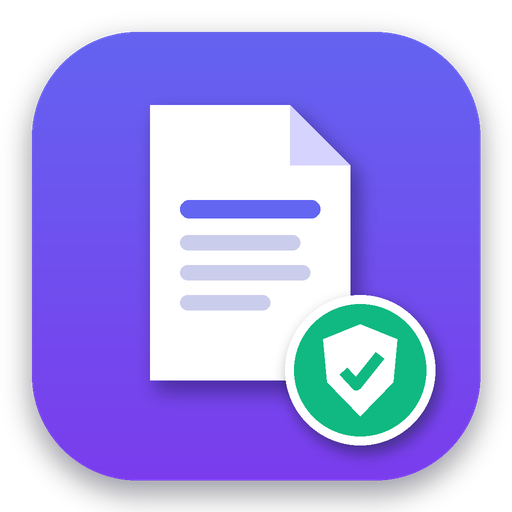
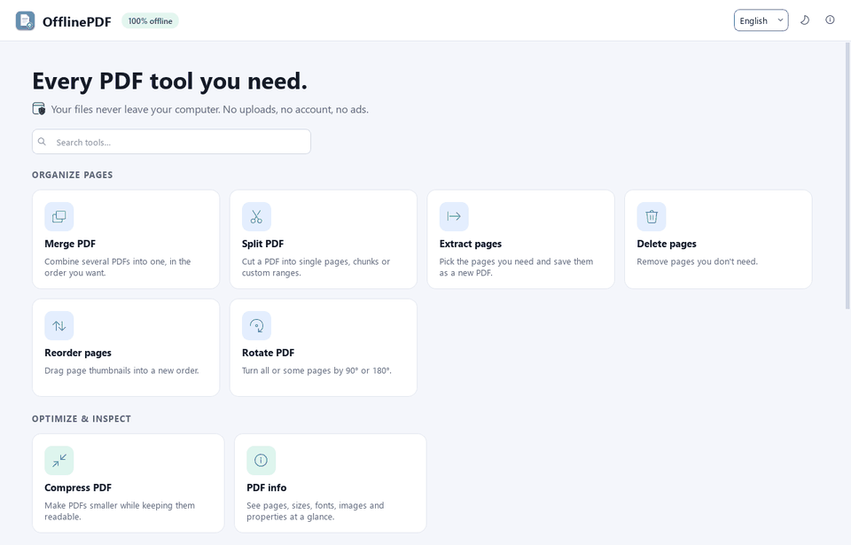
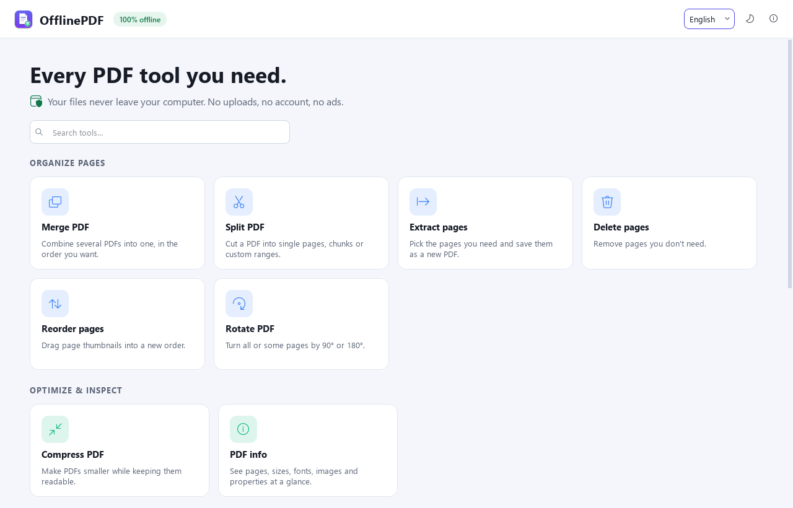
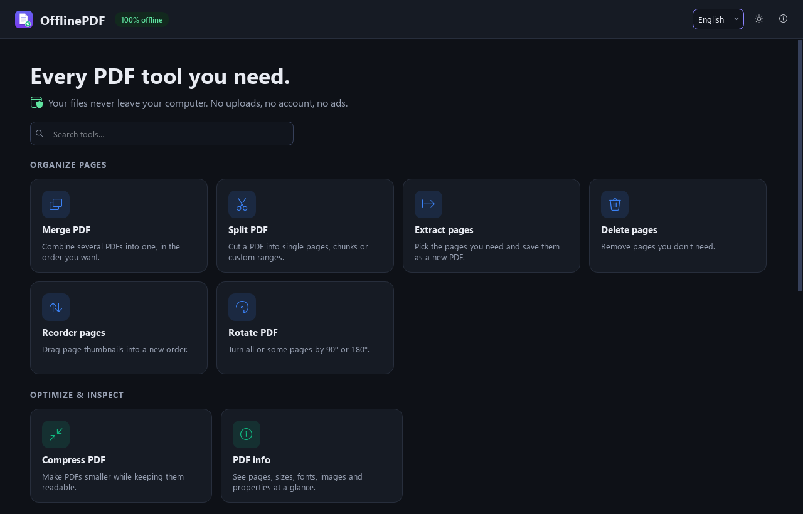
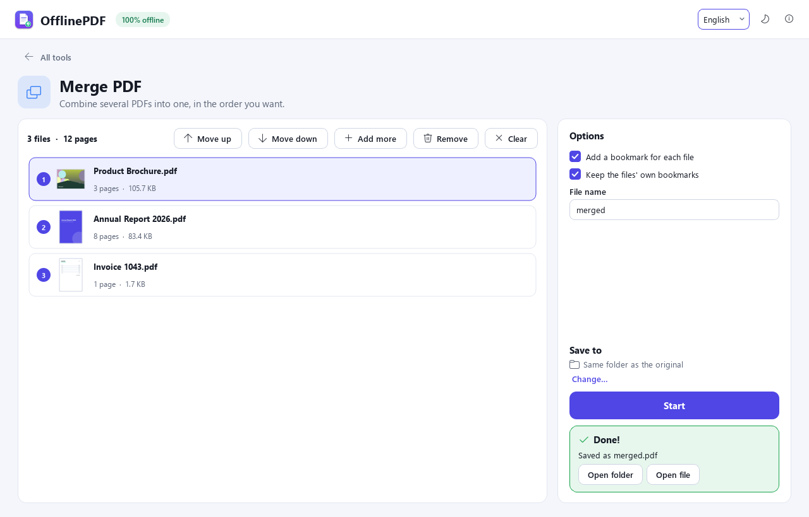
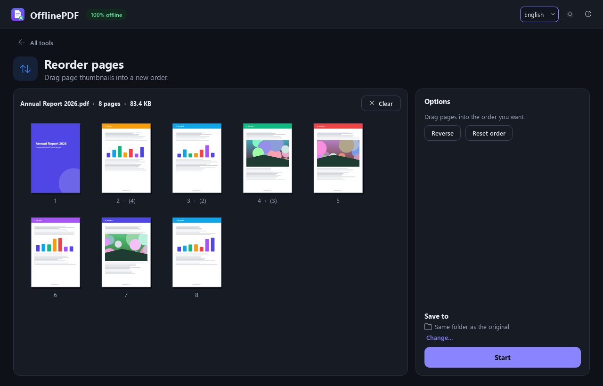
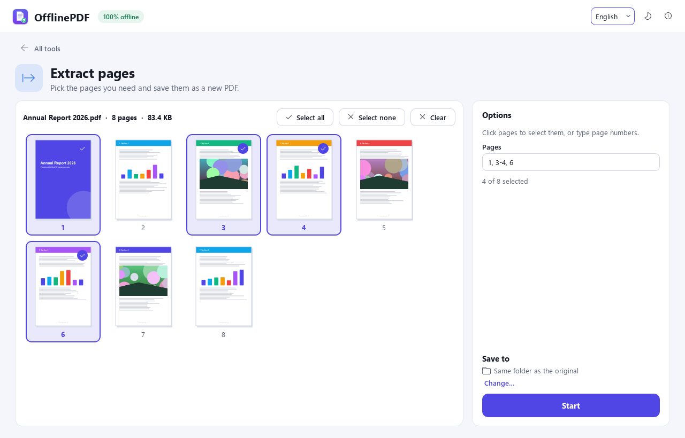
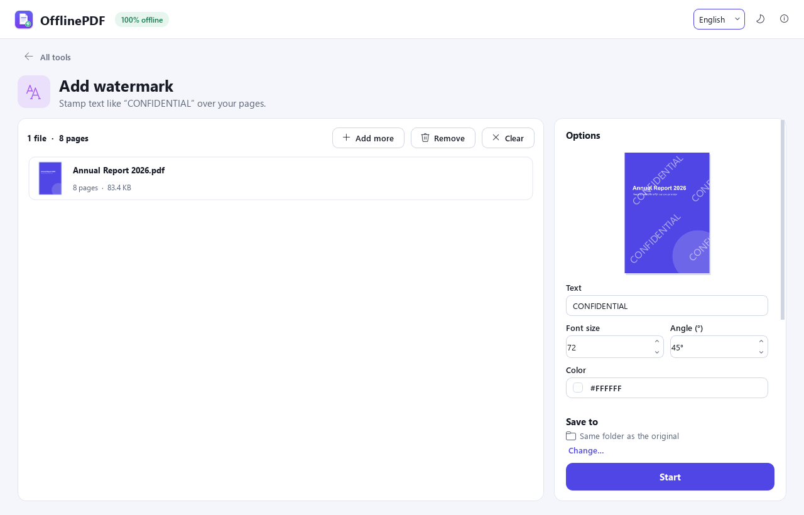
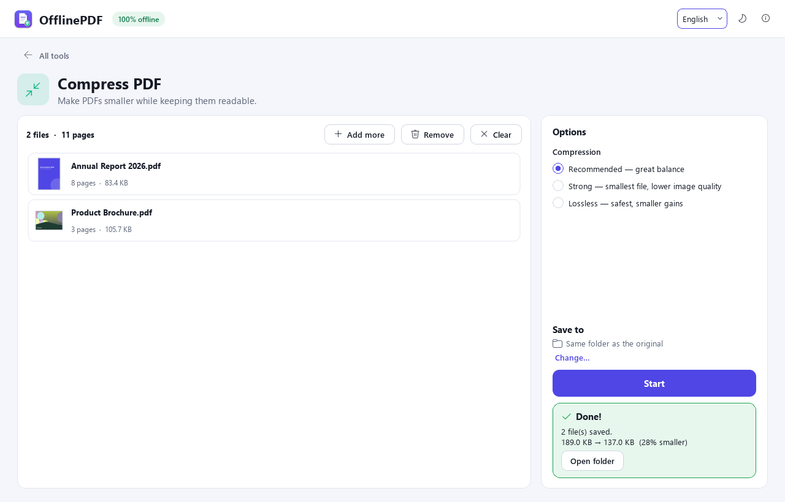
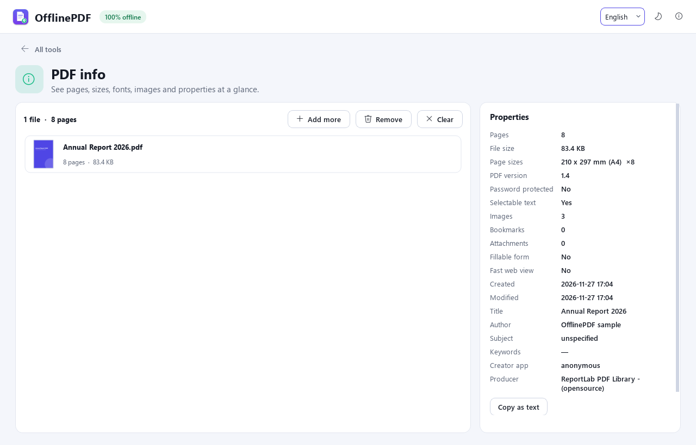

<div align="center">



# OfflinePDF

**Every PDF tool you need — and your files never leave your computer.**

Merge, split, compress, convert, watermark, number, protect and inspect PDFs.<br>
Free and open source. No uploads, no account, no ads, no limits.

[](LICENSE)


[](https://github.com/demiralpozturk/offline-pdf/releases/latest)


[**Download for Windows**](https://github.com/demiralpozturk/offline-pdf/releases/latest) · [Features](#features) · [Command line](#command-line) · [Build from source](#build-from-source) · [Türkçe](#türkçe)



</div>

## Why OfflinePDF?

Online PDF sites are convenient, but every contract, invoice, ID scan or medical report you drop on them is uploaded to someone else's server. OfflinePDF gives you the same everyday tools as a normal desktop app:

- 🔒 **Private by design** — there is no networking code at all. It works with Wi-Fi turned off.
- ⚡ **Fast** — no upload/download wait, no file-size or daily limits.
- 🧰 **15 tools in one app** — with drag & drop, page thumbnails and batch processing.
- 🌍 **English and Turkish** — picks your system language; light and dark themes.
- 🧑‍💻 **Scriptable** — every tool is also available from the command line.
- 🆓 **Free forever** — MIT licensed, no watermarks on your output, no "pro" tier.

## Features

| | Tool | What it does |
|---|---|---|
| **Organize** | Merge PDF | Combine PDFs in any order; adds a bookmark per file and keeps existing bookmarks |
| | Split PDF | One file per page, chunks of N pages, or custom ranges like `1-3, 4-6, 7-` |
| | Extract pages | Click thumbnails (or type `1-3, 8`) and save just those pages |
| | Delete pages | Remove the pages you don't need |
| | Reorder pages | Drag page thumbnails into a new order, reverse with one click |
| | Rotate PDF | 90° / 180° / 270°, all pages or a selection, many files at once |
| **Optimize** | Compress PDF | Three levels; re-encodes oversized photos only when it actually helps — never makes a file bigger |
| | PDF info | Pages, page sizes, version, images, bookmarks, forms, text layer, all metadata |
| **Convert** | Images → PDF | JPG, PNG, WEBP, TIFF, BMP, GIF; keeps JPEG quality, respects photo rotation, fit / A4 / Letter |
| | PDF → images | PNG or JPG at 72–600 DPI |
| **Edit** | Watermark | Centered or tiled text, any color/angle/opacity, live preview, Unicode (ğ, ş, İ…) |
| | Page numbers | 6 positions, formats like `{n} / {total}` or `Page {n}`, skip the cover page |
| | Edit metadata | Change title/author/subject/keywords — or wipe all metadata before sharing |
| **Security** | Protect PDF | AES-256 password with print / copy / edit permissions |
| | Unlock PDF | Remove the password from a file you can open (it does **not** crack passwords) |

Password-protected input files are supported everywhere: OfflinePDF asks for the password once.

## Screenshots

| Light | Dark |
|---|---|
|  |  |
|  |  |
|  |  |
|  |  |

## Download

1. Download `OfflinePDF-<version>-windows-x64.zip` from the [latest release](https://github.com/demiralpozturk/offline-pdf/releases/latest).
2. Unzip it anywhere (no installation, no admin rights needed).
3. Run `OfflinePDF.exe`.

> **Windows SmartScreen:** the app is not code-signed yet, so Windows may say "Windows protected your PC". Click **More info → Run anyway**. The source is right here, and you can [build it yourself](#build-from-source).

## Command line

The release also contains `offlinepdf-cli.exe` (or run `python -m offlinepdf.cli` from source):

```powershell
offlinepdf-cli merge cover.pdf report.pdf appendix.pdf -o final.pdf
offlinepdf-cli split big.pdf --every 10
offlinepdf-cli extract big.pdf --pages "1-3, 8" -o summary.pdf
offlinepdf-cli reorder scan.pdf --order "end-1"          # reverse all pages
offlinepdf-cli compress scan.pdf --level high
offlinepdf-cli images2pdf "photos\*.jpg" --page-size a4 --margin 10 -o album.pdf
offlinepdf-cli pdf2images slides.pdf --format jpg --dpi 200
offlinepdf-cli watermark contract.pdf --text "CONFIDENTIAL" --tiled --opacity 0.2
offlinepdf-cli numbers thesis.pdf --format "Page {n} of {total}" --skip-first
offlinepdf-cli protect salary.pdf --new-password "s3cret" --no-copy
offlinepdf-cli metadata cv.pdf --strip
offlinepdf-cli info report.pdf --json
```

Without `-o`, results are saved next to the input with a suffix (`_compressed`, `_rotated`…) and existing files are never overwritten.

## Privacy

- No networking code, no telemetry, no update checks, no crash reporting.
- Files are only read from and written to the folders you choose.
- The only links are in the About dialog and footer (GitHub / project page); they open in your browser when you click them.

## Build from source

Requires Python 3.10+ on Windows (the core also works on Linux/macOS).

```powershell
git clone https://github.com/demiralpozturk/offline-pdf
cd offline-pdf
python -m venv .venv
.venv\Scripts\activate
pip install -r requirements-dev.txt

python -m offlinepdf            # run the app
python -m pytest                # 47 tests: core, CLI and headless UI
python scripts/build.py         # build dist\OfflinePDF + zip, then self-test the .exe
python scripts/screenshots.py   # regenerate README screenshots and demo GIF
```

`OfflinePDF.exe --selftest <folder>` runs every tool on generated documents, builds the whole UI off-screen and writes `report.json` — handy for checking a build on another machine.

### Project structure

Every file is plain, readable Python — open any of them on GitHub and follow along.

```
offline-pdf/
├── offlinepdf/                 the application package
│   ├── core/                   PDF engine: plain functions, no UI, fully tested
│   │   ├── organize.py         merge, split, extract, delete, reorder, rotate
│   │   ├── optimize.py         compression (image re-encoding + object streams)
│   │   ├── convert.py          images → PDF, PDF → images
│   │   ├── overlay.py          text watermarks and page numbers
│   │   ├── security.py         AES-256 password protection and removal
│   │   ├── metadata.py         read / edit / strip metadata, PDF summary
│   │   ├── render.py           page rendering with PDFium (thumbnails, PDF → images)
│   │   ├── pages.py            page-range parsing ("1-3, 7, 10-")
│   │   ├── document.py         safe open/save helpers, output file names
│   │   └── errors.py           errors with stable codes the UI translates
│   ├── ui/                     PySide6 (Qt) desktop interface
│   │   ├── main_window.py      header bar + home / tool pages
│   │   ├── home.py             start screen: search and tool cards
│   │   ├── tool_page.py        one screen per tool: files left, options right
│   │   ├── tools.py            the 15 tools: options and how they call core/
│   │   ├── widgets.py          drop zone, file list, page thumbnail grid
│   │   ├── worker.py           runs slow work off the UI thread
│   │   ├── theme.py            light and dark themes
│   │   ├── icons.py            icons from the Windows icon fonts
│   │   ├── about.py            About dialog (author links)
│   │   └── resources.py        paths to bundled assets
│   ├── app.py                  application entry point
│   ├── cli.py                  `offlinepdf-cli` command line
│   ├── i18n.py                 every user-facing text, English + Turkish
│   ├── app_info.py             author and contact links (the only place to edit them)
│   ├── samples.py              generates sample documents for tests and screenshots
│   └── selftest.py             headless end-to-end check, also used on the packaged .exe
├── tests/                      pytest suite: core, CLI and headless UI (47 tests)
├── scripts/
│   ├── build.py                PyInstaller build → zip → self-test of the .exe
│   ├── screenshots.py          README screenshots and demo GIF, rendered off-screen
│   ├── make_icon.py            draws the app icon
│   └── entry_gui.py / entry_cli.py   entry points for the packaged executables
├── docs/                       demo GIF and screenshots used in this README
├── assets/                     app icon
└── .github/                    issue and pull request templates
```

## Built with

| Library | Used for | License |
|---|---|---|
| [PySide6](https://doc.qt.io/qtforpython-6/) (Qt) | User interface | LGPL-3.0 |
| [pikepdf](https://github.com/pikepdf/pikepdf) / [qpdf](https://github.com/qpdf/qpdf) | Page operations, encryption, compression | MPL-2.0 / Apache-2.0 |
| [pypdf](https://github.com/py-pdf/pypdf) | Merging with bookmarks | BSD-3-Clause |
| [pypdfium2](https://github.com/pypdfium2-team/pypdfium2) / PDFium | Thumbnails, PDF → image, text checks | Apache-2.0 / BSD-3-Clause |
| [Pillow](https://python-pillow.org/) | Image handling | MIT-CMU |
| [ReportLab](https://www.reportlab.com/opensource/) | Watermarks, page numbers, images → PDF | BSD-3-Clause |

No AGPL/GPL dependencies, so OfflinePDF can stay MIT licensed.

## Roadmap

- [ ] Installer (MSIX / Inno Setup) and code signing
- [ ] Crop pages, N-up (several pages per sheet)
- [ ] Draw / place a signature image
- [ ] Optional OCR for scanned PDFs (Tesseract)
- [ ] Redaction
- [ ] More languages — translations welcome!

Have an idea? [Open an issue](https://github.com/demiralpozturk/offline-pdf/issues/new/choose).

## Contributing

Bug reports, translations and pull requests are welcome — see [CONTRIBUTING.md](CONTRIBUTING.md). The one hard rule: OfflinePDF must stay 100% offline.

If OfflinePDF saved you an upload, a ⭐ on GitHub helps others find it.

## Author

**Creator: Demiralp Öztürk** — [GitHub](https://github.com/demiralpozturk) · [LinkedIn](https://www.linkedin.com/in/demiralp-%C3%B6zt%C3%BCrk/)

## License

[MIT](LICENSE) © 2026 Demiralp Öztürk

---

## Türkçe

**İhtiyacın olan tüm PDF araçları — üstelik dosyaların bilgisayarından hiç çıkmaz.**

OfflinePDF; PDF birleştirme, bölme, sıkıştırma, dönüştürme, filigran, sayfa numarası, şifreleme ve daha fazlasını tek bir ücretsiz ve açık kaynak Windows uygulamasında toplar. İnternet sitelerine sözleşme, fatura, kimlik ya da sağlık raporu yüklemene gerek kalmaz.

### Neden OfflinePDF?

- 🔒 **Gizlilik:** Uygulamada internet bağlantısı kuran tek satır kod yok. Wi-Fi kapalıyken de çalışır.
- ⚡ **Hızlı:** Yükleme/indirme beklemesi, dosya boyutu ya da günlük kullanım sınırı yok.
- 🧰 **15 araç tek uygulamada:** Sürükle-bırak, sayfa küçük resimleri, toplu işlem.
- 🇹🇷 **Tamamen Türkçe arayüz:** Sistem dilini otomatik seçer; açık ve koyu tema.
- 🆓 **Sonsuza dek ücretsiz:** MIT lisanslı; çıktılarına filigran eklemez, "pro" sürümü yok.

### Araçlar

| Araç | Ne yapar |
|---|---|
| PDF birleştir | Dosyaları istediğin sırayla birleştirir, her dosya için yer imi ekler |
| PDF böl | Her sayfayı ayrı dosya, N sayfalık parçalar ya da `1-3, 4-6, 7-` gibi aralıklar |
| Sayfa çıkar / sil | Küçük resimlere tıklayarak ya da numara yazarak seç |
| Sayfaları sırala | Sayfaları sürükleyerek yeni sıra ver |
| PDF döndür | 90° / 180° / 270°, tüm ya da seçili sayfalar |
| PDF sıkıştır | Üç seviye; dosyayı asla büyütmez |
| PDF bilgisi | Sayfa, boyut, sürüm, resim, yer imi, form ve tüm bilgiler |
| Resimden PDF'e | JPG, PNG, WEBP, TIFF…; JPEG kalitesini korur, A4 / Letter / resim boyutu |
| PDF'ten resme | 72–600 DPI arası PNG ya da JPG |
| Filigran ekle | Ortada ya da döşeli yazı, canlı önizleme, Türkçe karakter desteği |
| Sayfa numarası | 6 konum, `{n} / {total}` gibi biçimler, kapak sayfasını atlama |
| Bilgileri düzenle | Başlık/yazar/konu değiştir ya da paylaşmadan önce tüm gizli bilgileri sil |
| PDF şifrele / şifre kaldır | AES-256 parola ve izinler; şifre kırmaz, yalnızca bildiğin parolayı kaldırır |

### İndirme ve kurulum

1. [Son sürümden](https://github.com/demiralpozturk/offline-pdf/releases/latest) `OfflinePDF-<sürüm>-windows-x64.zip` dosyasını indir.
2. Zip'i istediğin yere çıkar (kurulum ya da yönetici izni gerekmez).
3. `OfflinePDF.exe` dosyasını çalıştır.

> **Windows SmartScreen uyarısı:** Uygulama henüz kod imzalı değil. "Windows bilgisayarınızı korudu" uyarısı çıkarsa **Ek bilgi → Yine de çalıştır** de. Kaynak kod burada; istersen kendin derleyebilirsin.

### Komut satırı

`offlinepdf-cli.exe` ile tüm araçları betiklerden kullanabilirsin:

```powershell
offlinepdf-cli merge kapak.pdf rapor.pdf -o son.pdf
offlinepdf-cli compress tarama.pdf --level high
offlinepdf-cli watermark sozlesme.pdf --text "GİZLİDİR" --tiled
offlinepdf-cli numbers tez.pdf --format "Sayfa {n} / {total}" --skip-first
```

### Katkı

Hata bildirimleri, çeviriler ve pull request'ler memnuniyetle karşılanır — bkz. [CONTRIBUTING.md](CONTRIBUTING.md). Tek kesin kural: OfflinePDF her zaman %100 çevrimdışı kalacak.

Beğendiysen GitHub'da ⭐ vererek başkalarının da bulmasına yardım edebilirsin.

### Proje yapısı

Kod klasörlere ayrılmış, her dosya tek bir işi yapıyor; GitHub'da istediğin dosyayı açıp takip edebilirsin.

| Klasör / dosya | Ne yapar |
|---|---|
| `offlinepdf/core/` | PDF motoru: arayüzden bağımsız, testli fonksiyonlar (birleştirme, bölme, sıkıştırma, dönüştürme, filigran, şifreleme, meta veri) |
| `offlinepdf/ui/` | PySide6 masaüstü arayüzü: ana ekran, araç sayfaları, küçük resimler, temalar |
| `offlinepdf/cli.py` | `offlinepdf-cli` komut satırı |
| `offlinepdf/i18n.py` | Uygulamadaki tüm metinler, Türkçe + İngilizce |
| `offlinepdf/app_info.py` | Yazar ve iletişim bağlantıları |
| `offlinepdf/selftest.py` | Pencere açmadan uçtan uca kontrol (paketli exe'de de çalışır) |
| `tests/` | 47 pytest testi |
| `scripts/` | Derleme, ekran görüntüsü/GIF üretimi, simge |

Ayrıntılı ağaç için yukarıdaki [Project structure](#project-structure) bölümüne bak.

**Creator: Demiralp Öztürk** — [GitHub](https://github.com/demiralpozturk) · [LinkedIn](https://www.linkedin.com/in/demiralp-%C3%B6zt%C3%BCrk/)
